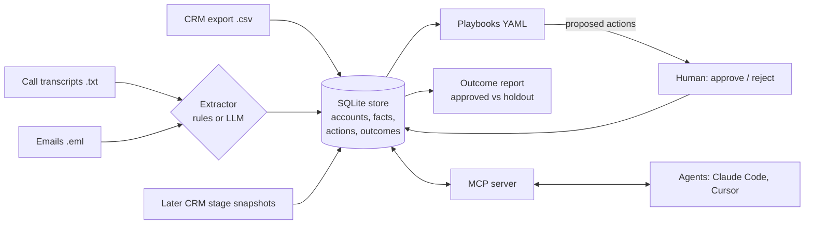

# revloop

Keep GTM context current for sales teams and AI agents, and measure whether the actions agents propose actually move deals.

## The problem

What a team knows about a deal is spread across call recordings, email threads, and the CRM, and it changes every week. The stage moves, a new competitor shows up, the next step gets replaced. An agent that drafts an email from last month's context will write the wrong email.

There is a second gap. Teams add agents that propose follow-ups, but almost nobody checks whether those follow-ups changed anything. Did the deals that got the re-engagement email move faster than the ones that did not?

revloop is a small tool I built to work on both problems: one store of current, sourced facts per account, and a simple before/after comparison for every playbook.

## What revloop does

1. **Context extractors.** Turns call transcripts (`.txt`), emails (`.eml`), and CRM CSV exports into structured facts. Each fact has an account, a kind, a value, a source (file and line), and a timestamp. Kinds: `pain`, `objection`, `competitor`, `next_step`, `stakeholder`, `stage`, `amount`. The default extractor is a set of deterministic keyword and pattern rules that runs offline. If `ANTHROPIC_API_KEY` is set, an LLM extractor that asks Claude for schema-constrained JSON is used instead (install with `uv sync --extra llm`). CRM columns from HubSpot and Salesforce exports are both recognised ("Company name" or "Account Name", "Deal Stage" or "Stage", and so on).
2. **Memory.** A SQLite store. For single-valued kinds (`stage`, `amount`, `next_step`) a newer fact supersedes the older one, so the current view stays current, and the old fact is kept as history. Multi-valued kinds (`pain`, `objection`, `competitor`, `stakeholder`) accumulate and are deduplicated.
3. **Playbooks.** YAML files with trigger conditions over the store and action templates filled from facts. Two ship with the repo: `stalled-deal` and `competitor-mentioned`. Actions are only proposed. A person approves or rejects each one. revloop never sends anything anywhere.
4. **Outcome measurement.** Import later CRM stage snapshots, and revloop compares, per playbook, accounts that got an approved action against accounts that matched the same trigger but got none. It reports the share that advanced stage within a window and the difference between the two groups.
5. **MCP server.** Exposes the store to any MCP client (Claude Code, Cursor) through five tools: `get_account_context`, `search_facts`, `propose_action`, `list_pending_actions`, `outcome_report`.

## Quickstart

Requires [uv](https://docs.astral.sh/uv/) and Python 3.12. Run from the repository root. The `--now` flags pin the evaluation date so the fictional example data gives the same result whenever you run it.

```bash
uv sync
uv run revloop init
uv run revloop ingest examples/artifacts
uv run revloop context "Northwind Robotics" --history

uv run revloop run stalled-deal --now 2026-09-30
uv run revloop run competitor-mentioned --now 2026-09-30
uv run revloop actions

uv run revloop approve 1    # re-engagement email for Acme Freight
uv run revloop reject 2     # Harbor Health has no call or email facts, so the draft is empty
uv run revloop approve 3    # CRM note about the competitor at Northwind Robotics

uv run revloop outcomes import examples/outcomes.csv
uv run revloop report --now 2026-11-01
```

The last command prints:

```
Share of matched accounts that advanced stage within 30 days of the match

competitor-mentioned
  approved action : 1/1 advanced (100%)
  holdout         : 0/0 advanced (0%)
  uplift          : not enough data (need >= 10 accounts per group)

stalled-deal
  approved action : 1/1 advanced (100%)
  holdout         : 0/1 advanced (0%)
  uplift          : not enough data (need >= 10 accounts per group)

Not a randomised test: a human chose which actions to approve, so selection bias is likely.
```

Four example accounts is far too few to say anything, and the report says so.

Every command takes `--db PATH` (default `./revloop.db`). Run tests with `uv run pytest`.

## MCP setup for Claude Code

```bash
claude mcp add revloop -- uv run --directory /path/to/revloop revloop --db /path/to/revloop/revloop.db mcp
```

Or in a project `.mcp.json`:

```json
{
  "mcpServers": {
    "revloop": {
      "command": "uv",
      "args": ["run", "--directory", "/path/to/revloop", "revloop", "--db", "/path/to/revloop/revloop.db", "mcp"]
    }
  }
}
```

`propose_action` only records a proposal with status `proposed`. A person still runs `revloop approve <id>`.

## Architecture



| Module | Role |
| --- | --- |
| `facts.py` | Fact model, kinds, stage normalisation |
| `extract.py` | Transcript, email, and CRM parsing; rule-based extractor |
| `llm.py` | Optional Claude extractor with JSON schema output |
| `store.py` | SQLite schema, supersede and dedupe logic |
| `playbooks.py` | YAML loading, trigger evaluation, template rendering |
| `outcomes.py` | Snapshot import, approved vs holdout comparison |
| `server.py` | MCP tools |
| `cli.py` | `revloop` command |

## Playbook format

```yaml
name: stalled-deal
description: A late-stage deal has gone quiet.
trigger:
  stage_in: [proposal, negotiation]   # current stage is one of these
  no_new_facts_days: 21               # no fact of any kind in the last 21 days
  # has_kind: [competitor]            # every listed kind has at least one current fact
actions:
  - type: email_draft
    template: |
      Hi {stakeholder}, you mentioned "{pain}" and raised "{objection}".
```

All trigger conditions must hold. Templates can use `{account}` and any fact kind; each placeholder gets the most recent current value of that kind, or `(none recorded)` if there is none, so a reviewer sees the gap instead of a made-up detail. A playbook proposes actions for an account once; running it again skips accounts it has already handled.

Stage names are normalised to `prospecting`, `qualification`, `discovery`, `demo`, `proposal`, `negotiation`, `closed_won`, with common HubSpot and Salesforce stage names mapped onto them (for example `contractsent` and `Negotiation/Review` both become `negotiation`).

## How outcome measurement works, and its limits

- When a playbook matches an account, revloop records the match time and the account's stage at that moment.
- An account counts as **advanced** if any imported stage snapshot within the window (default 30 days, `--window`) shows a later stage in the order above. `closed_lost` never counts as advancing.
- **Approved** group: matches where at least one proposed action was approved. **Holdout** group: matches where nothing was approved (rejected or never reviewed).
- Matches whose window has not closed yet, and matches where the starting stage is unknown, are left out and counted separately.
- With at least 10 accounts in each group, revloop prints the uplift (difference in advance rates) and a pooled two-proportion z-test. Below that it prints "not enough data".

Limits, stated plainly:

- This is not a controlled experiment. People choose what to approve, and they may approve actions for deals that were already healthy. Treat the uplift as a signal to investigate, not as proof. A proper test would randomly hold out some matches before review.
- The rule-based extractor is keyword matching. It is predictable and testable, but it misses paraphrases and can pick up false positives (for example, it treats any capitalised name after "evaluating" as a competitor). The LLM extractor reads text better but is not deterministic.
- A playbook handles each account once, so an account that stalls a second time is not re-proposed.
- Time is measured from CRM and artifact timestamps. If those are wrong, the report is wrong.

## How it differs from YALC and Clay

[YALC](https://github.com/Othmane-Khadri/YALC-the-GTM-operating-system) and [Clay](https://www.clay.com/) focus on finding and enriching leads and running outbound campaigns, and they do that well. revloop does not enrich or send anything. It focuses on the part after the first touch: keeping each account's changing context current for the people and agents working the deal, and checking whether the actions they take moved pipeline. They work well together: use YALC or Clay to start conversations, and revloop to keep track of what those conversations taught you and whether your follow-ups helped.

## Credits

Inspired by YALC by Othmane Khadri (MIT). No YALC code is used.

## License

MIT. See [LICENSE](LICENSE).
