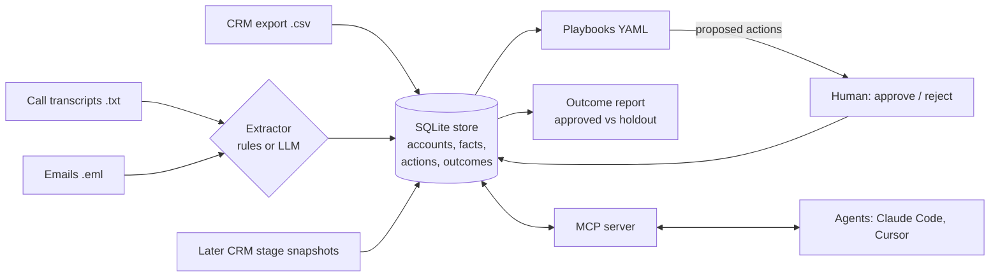

<div align="center">

# revloop

### Shared memory for GTM teams and their AI agents, with a scoreboard attached.

[](https://github.com/shubham-bhatnagar-78/revloop/actions/workflows/ci.yml)
[](LICENSE)
[](https://www.python.org/)
[](https://modelcontextprotocol.io/)

</div>

---

> Your CRM says the deal is in negotiation.
> The call from Tuesday says it's dead.
> Your agent just wrote a follow-up based on the CRM.

Everything a team knows about a deal is scattered across calls, emails, and the CRM, and it changes every week. An agent drafting from last month's context writes the wrong email, confidently. And almost nobody checks whether the follow-ups their agents propose changed anything at all.

revloop is a small, self-hosted tool for both halves: **one current view of every account with provenance on every fact**, and **a straight comparison that tells you whether approved actions actually moved pipeline**.

## See it

Three sources disagree about Northwind Robotics. revloop keeps the newest and remembers the rest:

```console
$ revloop context "Northwind Robotics" --history

next_step   Send security questionnaire responses by Friday
            emails/2026-09-15-northwind-robotics.eml:12   2026-09-15
  superseded  Legal review of the MSA
              crm/salesforce-opportunities.csv:3          2026-09-10
  superseded  Loop in their CISO for the security review
              calls/2026-09-08-northwind-robotics.txt:24  2026-09-08

stage       negotiation      crm/salesforce-opportunities.csv:3
competitor  Vantage          calls/2026-09-08-northwind-robotics.txt:18
pain        Manual reconciliation eats two days a month
objection   Procurement needs SOC 2 before signing
```

Every fact carries the file and line it came from. Nothing is invented, and an agent reading this can cite its source.

Later, once deals have had time to move:

```console
$ revloop report

Share of matched accounts that advanced stage within 30 days of the match

stalled-deal
  approved action : 1/1 advanced (100%)
  holdout         : 0/1 advanced (0%)
  uplift          : not enough data (need >= 10 accounts per group)

Not a randomised test: a human chose which actions to approve, so selection bias is likely.
```

A measurement tool that refuses to claim an effect it cannot support. That is the whole idea.

## Who this is for

- You are wiring agents into a GTM stack and need them to read something better than a stale CRM field.
- You already have agents proposing follow-ups and cannot prove they help.
- You want the context layer on your own machine, in SQLite, in files you can read.

Not for you if you want lead enrichment or an outbound sender. revloop deliberately does neither.

## What it does

| | |
| --- | --- |
| **Extract** | Call transcripts, `.eml` emails, and CRM CSVs become structured facts: `pain`, `objection`, `competitor`, `next_step`, `stakeholder`, `stage`, `amount`. HubSpot and Salesforce column names both recognised. Offline rules by default, Claude with schema-constrained JSON when you want it. |
| **Remember** | SQLite. A newer `stage`, `amount`, or `next_step` supersedes the old one, so current stays current and history is kept. Pains, objections, competitors, and stakeholders accumulate and dedupe. |
| **Propose** | YAML playbooks match conditions over the store and fill templates from real facts. Actions are only ever **proposed**. A person approves. revloop sends nothing, anywhere, ever. |
| **Measure** | Import later CRM stage snapshots. Per playbook, accounts with an approved action are compared against accounts that matched the same trigger and got none. |
| **Serve** | An MCP server hands the whole store to Claude Code, Cursor, or any MCP client through five tools. |

## Quickstart

Needs [uv](https://docs.astral.sh/uv/) and Python 3.12. The `--now` flags pin the date so the fictional sample data gives the same answer whenever you run it.

```bash
uv sync
uv run revloop init
uv run revloop ingest examples/artifacts
uv run revloop context "Northwind Robotics" --history

uv run revloop run stalled-deal --now 2026-09-30
uv run revloop run competitor-mentioned --now 2026-09-30
uv run revloop actions

uv run revloop approve 1    # re-engagement email for Acme Freight
uv run revloop reject 2     # Harbor Health has no call or email facts, so the draft is empty
uv run revloop approve 3    # CRM note about the competitor at Northwind Robotics

uv run revloop outcomes import examples/outcomes.csv
uv run revloop report --now 2026-11-01
```

Every command takes `--db PATH` (default `./revloop.db`). Tests: `uv run pytest`.

## Give it to your agent

```bash
claude mcp add revloop -- uv run --directory /path/to/revloop revloop --db /path/to/revloop/revloop.db mcp
```

Or in a project `.mcp.json`:

```json
{
  "mcpServers": {
    "revloop": {
      "command": "uv",
      "args": ["run", "--directory", "/path/to/revloop", "revloop", "--db", "/path/to/revloop/revloop.db", "mcp"]
    }
  }
}
```

Tools: `get_account_context`, `search_facts`, `propose_action`, `list_pending_actions`, `outcome_report`.

`propose_action` records a proposal with status `proposed`. A person still runs `revloop approve <id>`. **An agent cannot approve its own work.**

## Architecture



| Module | Role |
| --- | --- |
| `facts.py` | Fact model, kinds, stage normalisation |
| `extract.py` | Transcript, email, and CRM parsing; rule-based extractor |
| `llm.py` | Optional Claude extractor with JSON schema output |
| `store.py` | SQLite schema, supersede and dedupe logic |
| `playbooks.py` | YAML loading, trigger evaluation, template rendering |
| `outcomes.py` | Snapshot import, approved vs holdout comparison |
| `server.py` | MCP tools |
| `cli.py` | `revloop` command |

**894 lines of source. 36 tests. Two dependencies.** No daemon, no account, no cloud.

## Writing a playbook

```yaml
name: stalled-deal
description: A late-stage deal has gone quiet.
trigger:
  stage_in: [proposal, negotiation]   # current stage is one of these
  no_new_facts_days: 21               # no fact of any kind in the last 21 days
  # has_kind: [competitor]            # every listed kind has at least one current fact
actions:
  - type: email_draft
    template: |
      Hi {stakeholder}, you mentioned "{pain}" and raised "{objection}".
```

All trigger conditions must hold. Templates take `{account}` and any fact kind; each placeholder gets the most recent current value, or `(none recorded)` if there is none, so a reviewer sees the gap instead of a fabricated detail. A playbook handles each account once.

Stages normalise to `prospecting`, `qualification`, `discovery`, `demo`, `proposal`, `negotiation`, `closed_won`, with common HubSpot and Salesforce names mapped on (`contractsent` and `Negotiation/Review` both become `negotiation`).

## How the measurement works

- When a playbook matches an account, revloop records the match time and the stage at that moment.
- An account **advanced** if any imported snapshot within the window (default 30 days, `--window`) shows a later stage. `closed_lost` never counts.
- **Approved**: matches where at least one action was approved. **Holdout**: matches where nothing was approved, whether rejected or never reviewed.
- Matches whose window is still open, or whose starting stage is unknown, are excluded and counted separately.
- With at least 10 accounts per group it prints the uplift and a pooled two-proportion z-test. Below that it says so.

## What it will not do

Stated plainly, because a tool that measures things should be honest about its own limits.

- **This is not a controlled experiment.** People choose what to approve, and they tend to approve actions for deals that already look healthy. Treat uplift as a signal to investigate, not proof. A proper test randomly holds out some matches before review.
- **The rule extractor is keyword matching.** Predictable and testable, but it misses paraphrases and produces false positives: any capitalised name after "evaluating" is read as a competitor. The LLM extractor reads text better and is not deterministic.
- **One proposal per account per playbook.** An account that stalls a second time is not re-proposed.
- **No enrichment, no sending.** revloop does not find leads, enrich records, or deliver a single message. It is the memory and the scoreboard. Pair it with whatever you already use to start conversations.
- **Timestamps are taken on trust.** If your CRM dates are wrong, the report is wrong.

## License

MIT. See [LICENSE](LICENSE).
